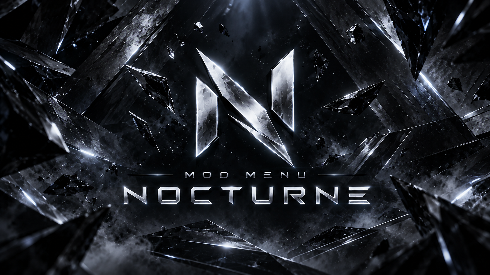

<div align="center">



# NocturneMenu

An open-source mod menu for Among Us, formerly known as OnyxMenu.

Built with BepInEx 6 and .NET 6.

[**Download**](https://github.com/Veltrix-s/OnyxMenu/releases/latest) · [**Discord**](https://discord.gg/cP4MrVUfM7) · [**Source Code**](https://github.com/Veltrix-s/OnyxMenu)

[](https://github.com/Veltrix-s/OnyxMenu/releases/latest)
[](https://github.com/Veltrix-s/OnyxMenu/releases)
[](https://github.com/Veltrix-s/OnyxMenu/releases)
[](https://github.com/Veltrix-s/OnyxMenu/stargazers)


[](LICENSE)

</div>

---

## About

Nocturne is a client-side mod menu for Among Us. It brings lobby and host tools, gameplay options, visuals, chat utilities, match replays, and a music player into one in-game interface.

The menu uses a dark theme with 24 accent colors, supports English and Russian, and includes search, collapsible sections, and customizable hotkeys. Settings are saved between sessions.

Press **`Insert`** to open or close the menu.

## Features

### Lobby & Hosting

- Custom lobby bar with host information, game timer, FPS, and ping
- Auto-host with player requirements, start delays, and auto-return options
- Lobby browser with host, code, platform, and lobby age information
- Start shortcuts and additional host settings
- Game rule options, including win conditions, role limits, and Hide & Seek settings
- Lobby clones with formations and movement options
- Fake map and lobby object controls
- Ban list, whitelist, player name history, level filters, and reserved colors

### Gameplay & Players

- Kill, vent, sabotage, and role-related options
- Movement, reach, cooldown, and teleport options
- Free camera, no-clip, and zoom
- Player information, role visibility, and meeting vote display
- Follow, morph, self-drag, and appearance options
- Other options for private and modded lobbies

### Visuals

- Player ESP with roles, boxes, and tracers
- Radar for players, bodies, and vents
- Task arrows and player information overlays
- Full-bright and visibility settings
- Options to skip intro, role reveal, and kill animations
- Cosmetic preview and saved outfits

### Chat

- Movable chat window with timestamps
- Chat presets, symbol picker, and extended input
- Chat commands and colored messages (`/c`, `/color`)
- Chat appearance settings

### Match Replay

- Record player positions and important round events
- Review kills, vents, sabotages, and meetings
- Timeline playback, seeking, and player focus
- Event filters for finding specific moments

### Music Player

- Play local music files directly from the menu
- 10-band equalizer with 28 presets
- Bass, stereo, crossfade, and other audio effects
- Live FFT spectrum and disc visualizer
- Playback controls and track navigation
- Supported Windows media-session controls

Put your music in `BepInEx/plugins/Nocturne/Music/` and press **`M`** to open the player.

### Settings & Utilities

- FPS counter and configurable FPS cap
- HUD scaling and in-game notifications
- 24 accent colors, English/Russian language selection, and UI search
- Customizable hotkeys and persistent settings
- Live connection, ping, and lobby information
- Platform, level, and other display/spoof options where supported
- Options to block analytics and diagnostic reporting

> Some features require you to be the host, depend on the current game version, or are intended only for private/modded lobbies.

## Hotkeys

| Key | Action |
| --- | --- |
| `Insert` | Open / close the menu |
| `M` | Open the music player |
| `F6` | Copy the lobby code |
| `[` / `]` | Previous / next track |
| `Esc` | Close the menu |

You can change hotkeys in **Settings → Hotkeys**.

## Installation

Nocturne requires **BepInEx 6 for IL2CPP**. Make sure the BepInEx build matches your Among Us installation and its architecture.

### 1. Install BepInEx

Download the appropriate IL2CPP build:

- [BepInEx releases](https://github.com/BepInEx/BepInEx/releases)
- [BepInEx bleeding-edge builds](https://builds.bepinex.dev/projects/bepinex_be)

Extract it into the folder containing `Among Us.exe` and `GameAssembly.dll`.

Your game folder should look roughly like this:

```text
Among Us/
├── Among Us.exe
├── GameAssembly.dll
├── winhttp.dll
├── dotnet/
└── BepInEx/
```

Run Among Us once, wait until the main menu appears, and close it. This lets BepInEx generate its folders and configuration files.

### 2. Install Nocturne

Get the current build from the [Releases page](https://github.com/Veltrix-s/OnyxMenu/releases/latest).

Place `NocturneMenu.dll` in:

```text
Among Us/BepInEx/plugins/NocturneMenu.dll
```

Start the game and press **`Insert`**.

If the release includes a preconfigured package, follow the instructions included with that package instead. Builds for different game distributions may not be interchangeable.

### Linux / Steam Deck

Install the Windows IL2CPP build of BepInEx and Nocturne in the game's installation folder as described above. Then add this to the game's Steam launch options:

```bash
WINEDLLOVERRIDES="winhttp.dll=n,b" %command%
```

Linux support runs through Proton and can vary by game version and distribution. Some Windows-specific features, including media-session integration, may not be available.

### Adding Music

Create the music folder if it does not exist:

```text
Among Us/BepInEx/plugins/Nocturne/Music/
```

Add supported local audio files such as `.mp3`, `.wav`, `.ogg`, or `.flac`, then open the player with **`M`**.

### Having Problems?

- Check that your Among Us and BepInEx builds match the version supported by the release.
- Make sure you installed the **IL2CPP** build of BepInEx, not the Mono build.
- Temporarily remove other mods to rule out conflicts.
- Check the BepInEx log for errors.
- Report reproducible issues on [Discord](https://discord.gg/cP4MrVUfM7), including the game version and relevant log output.

## Releases & Community

Download builds and read changelogs on the [Releases page](https://github.com/Veltrix-s/OnyxMenu/releases).

For bug reports, suggestions, and support, join the [Discord server](https://discord.gg/cP4MrVUfM7).

If you use Nocturne and want to support its development, a [GitHub star](https://github.com/Veltrix-s/OnyxMenu) helps other people find the project.

## Disclaimer

Nocturne is an unofficial third-party modification for Among Us.

The project is not affiliated with, endorsed by, sponsored by or approved by Innersloth LLC. Among Us and its related trademarks and assets belong to their respective owners.

Nocturne is intended for use in **private lobbies only**.

The software is provided **as-is**, without any warranty.

By installing or using Nocturne, you accept full responsibility for how you use it and for any consequences that may result, including account restrictions, bans, kicks, crashes, lost progress, corrupted files, game instability or incompatibility with future updates.

The developer is **not responsible for any consequences, damage or misuse resulting from the use of this software**.

Support is not provided for harassment, disruption of public games, unauthorized access, moderation evasion or other malicious activity.

For the best experience, disable or remove other mods before launching to avoid crashes and conflicts.

> **This mod is not affiliated with Among Us or Innersloth LLC, and the content contained therein is not endorsed or otherwise sponsored by Innersloth LLC. Portions of the materials contained herein are property of Innersloth LLC. © Innersloth LLC.**

---


## License

Nocturne is released under the [GNU General Public License v3.0](LICENSE). See the license file for the terms governing use, modification, and redistribution.

## Credits

Nocturne is an independent Among Us mod written in C#. The projects below were references for feature ideas and concepts:

- [MalumMenu](https://github.com/scp222thj/MalumMenu)
- [SickoMenu](https://github.com/g0aty/SickoMenu)
- [Hydra](https://github.com/MrDiamond64/Hydra)
- [ElysiumModMenu](https://github.com/Wextikit/ElysiumModMenu)

Libraries and APIs used include:

- [NAudio](https://github.com/naudio/NAudio) for audio playback
- [Windows Runtime media APIs](https://learn.microsoft.com/en-us/uwp/api/windows.media.control) for supported system media controls

---

---

<div align="center">

Made by **Kawasaki** 

</div>
